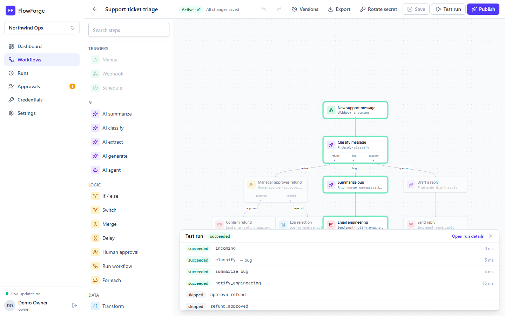
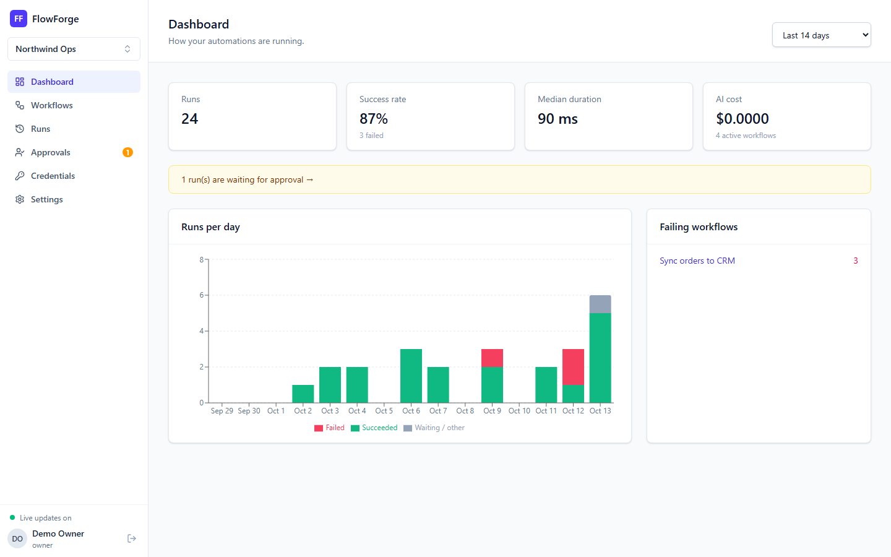
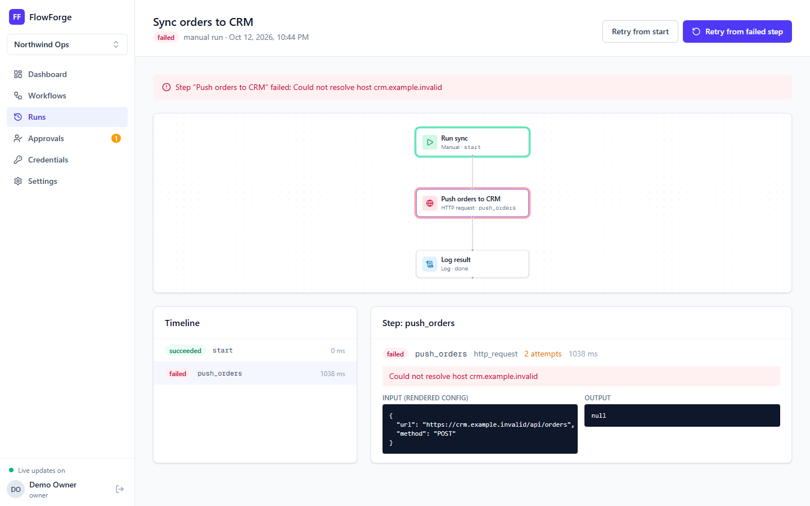
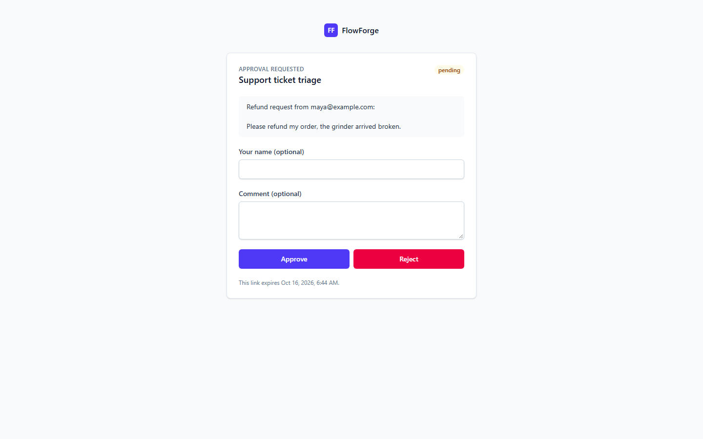
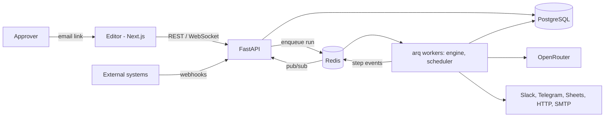

# FlowForge

[](https://github.com/Dozyboy/flowforge/actions/workflows/ci.yml)


[](LICENSE)

**Visual workflow automation with AI steps, human approvals and a reliable, observable execution engine.**

FlowForge lets a small team automate multi-step chores without writing code: a webhook receives a support message, an AI step classifies it, refunds wait for a manager to approve from an email link, bugs are summarized for engineering, and questions get a drafted reply. Every run is recorded step by step, can be watched live on the canvas, and can be resumed from the step that failed.



| Dashboard | Failed run with retry from the failed step | Approval from an email link |
|---|---|---|
|  |  |  |

## Highlights

| Area | What it does |
|---|---|
| **Editor** | React Flow canvas, forms generated from each node's JSON Schema, live validation, undo/redo, keyboard shortcuts, templates, JSON import/export |
| **Execution engine** | Persisted step-by-step execution: parallel branches, retries with exponential backoff, per-step timeouts, continue-on-error, cancellation, resume from the failed step |
| **Pausing** | Delay and human-approval steps release the worker and resume later; approvals by signed email link, no account needed |
| **Triggers** | Manual, webhook (secret + `Idempotency-Key`), cron schedule with time zones (`FOR UPDATE SKIP LOCKED`, safe with many workers) |
| **AI steps** | Summarize, classify (branches per label), extract (JSON Schema), generate, and a tool-using agent, via OpenRouter with token and cost tracking |
| **Integrations** | HTTP request, email, Slack, Telegram, Google Sheets (service-account JWT), sub-workflows and for-each loops |
| **Safety** | Sandboxed Jinja2 expressions, no arbitrary code nodes, SSRF-safe outbound HTTP, Fernet-encrypted credential vault |
| **Versioning** | Draft vs. published versions, every run pinned to the graph it ran, diff and restore |
| **SaaS platform** | Workspaces, roles (owner/admin/member/viewer), invitations, API keys, audit log, rate limits, plan limits (workflows, monthly runs, concurrency) |
| **Quality** | 91 backend tests on real Postgres/Redis, Vitest, Playwright E2E (webhook → approval email → finished run), strict typing, CI |

## Architecture



Details: [docs/ARCHITECTURE.md](docs/ARCHITECTURE.md) · Product and trade-offs: [docs/DESIGN.md](docs/DESIGN.md) · Decisions: [docs/adr](docs/adr)

## Tech stack

**Backend:** Python 3.12, FastAPI, SQLAlchemy 2 (async), Alembic, PostgreSQL 16, Redis, arq, Jinja2 (sandboxed), jsonschema, croniter, cryptography (Fernet), OpenAI SDK (via OpenRouter), structlog, Prometheus client
**Frontend:** Next.js (App Router), React 19, TypeScript, Tailwind CSS, React Flow (@xyflow/react), TanStack Query, react-hook-form + zod, Recharts
**Tooling:** uv, ruff, mypy, pytest, ESLint, Prettier, Vitest, Playwright, Docker Compose, GitHub Actions

## Quick start (Docker)

Requirements: Docker Desktop.

```bash
cp backend/.env.example backend/.env
# 1. Credential vault key (required to save credentials):
openssl rand -base64 32 | tr '+/' '-_'     # or: make credentials-key
#    -> paste it as CREDENTIALS_KEY=... in backend/.env
# 2. Either add your OpenRouter key (OPENROUTER_API_KEY=...) or run fully offline:
#    LLM_PROVIDER=fake

make up            # docker compose up -d --build --wait
make seed-docker   # demo data, once: docker compose exec api python -m app.scripts.seed
```

Stop with `make down` (data is kept; `docker compose down -v` deletes it). The projects in this family use the same ports, so run one stack at a time. `make help` lists every command.

| URL | What |
|---|---|
| http://localhost:3000 | App. Sign in with `demo@flowforge.dev` / `demo-password` |
| http://localhost:8000/docs | Interactive API documentation (OpenAPI) |
| http://localhost:8025 | Mailpit: every email the workflows send in development (including approval links) |

The seed creates four published workflows (support triage, lead qualification, daily digest and a CRM sync that fails on purpose) with two weeks of run history, including failed runs to retry and one run waiting for approval. Open Mailpit, click **Review and decide** in the "Approval needed" email, approve, and watch the run finish.

### Try a webhook

Publish a workflow with a webhook trigger, copy the secret shown once, then:

```bash
curl -X POST http://localhost:8000/api/v1/hooks/<workflow_id> \
  -H "Content-Type: application/json" \
  -H "X-FlowForge-Secret: <secret>" \
  -H "Idempotency-Key: order-1042" \
  -d '{"email": "sam@example.com", "message": "Please refund my order"}'
```

### Using a real model

1. Create a key at [openrouter.ai/keys](https://openrouter.ai/keys).
2. In `backend/.env` set `LLM_PROVIDER=openrouter` and `OPENROUTER_API_KEY=...`.
3. `docker compose up -d api worker` to reload.

Choose any chat model on OpenRouter with `OPENROUTER_CHAT_MODEL`, and add `OPENROUTER_FALLBACK_MODELS` for resilience.

## Local development

```bash
make infra        # Postgres, Redis, Mailpit in Docker
make install      # uv sync + npm ci
make migrate seed
make api          # http://localhost:8000
make worker       # runs, schedules and emails (run in WSL or Docker on Windows)
make web          # http://localhost:3000
```

Quality gates (the same ones CI runs):

```bash
make lint   # ruff, mypy, ESLint, tsc, Prettier
make test   # pytest (real Postgres + Redis) and Vitest
make e2e    # Playwright against a running stack
```

## Repository layout

```
backend/
  app/
    engine/        graph validation, expressions, executor, safe HTTP
      nodes/       one module per node family; registry of all node types
    api/v1/        HTTP and WebSocket routes (thin)
    services/      workflows, runs, webhooks, approvals, credentials, scheduler, dashboard
    core/          security, permissions, crypto, errors, rate limiting, realtime, logging, metrics, llm/
    models/        SQLAlchemy models        schemas/    Pydantic request/response models
    templates/     workflow gallery (JSON)  workers/    arq jobs and cron
  alembic/         migrations                tests/      unit + integration tests
frontend/
  src/app/         Next.js routes (dashboard, workflows, runs, approvals, credentials, settings)
  src/features/    editor (canvas, config forms, history), runs, workspace
  src/components/  shared UI                 src/lib/    API client, auth, realtime, types
  e2e/             Playwright tests
docs/              design, architecture, API, development, deployment, security, ADRs
```

## Documentation

- [DESIGN.md](docs/DESIGN.md): problem, personas, user stories, scope, trade-offs
- [ARCHITECTURE.md](docs/ARCHITECTURE.md): components, data model, execution engine
- [API.md](docs/API.md): endpoint overview, webhooks, approvals, examples
- [DEVELOPMENT.md](docs/DEVELOPMENT.md): conventions, testing, adding a node type
- [DEPLOYMENT.md](docs/DEPLOYMENT.md): running in production
- [SECURITY.md](docs/SECURITY.md): threat model and mitigations

## License

[MIT](LICENSE)
