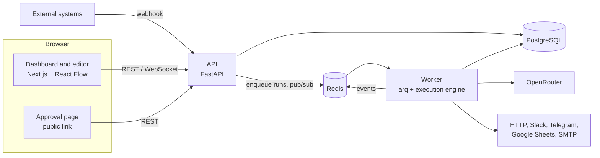
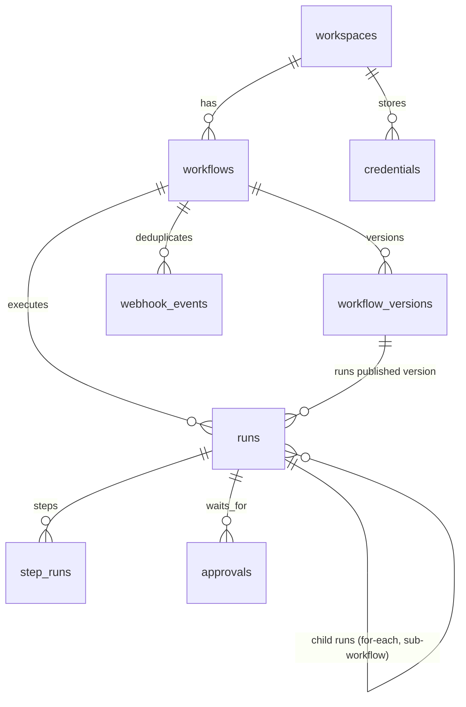
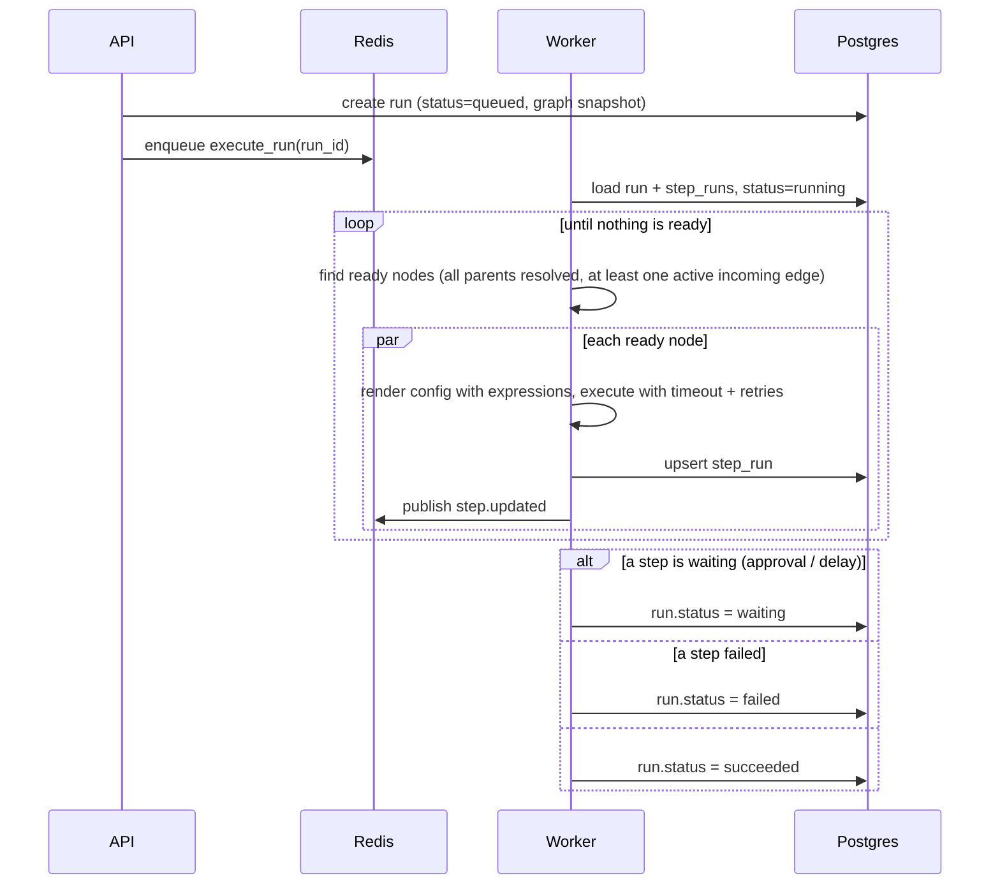

# FlowForge — Architecture

## 1. System overview



| Component | Responsibility |
|---|---|
| **API** | Auth, workspaces, workflow CRUD, validation, publishing, versions, credentials, webhooks, approvals, run queries, WebSocket hub |
| **Worker** | Executes runs (`execute_run` job), resumes paused runs, scheduler tick every minute, recovery of stuck runs |
| **Execution engine** (`app/engine`) | Graph model, validation, expression rendering, node registry, step executor |
| **PostgreSQL** | Workflows, versions, runs, step runs, approvals, credentials (encrypted) |
| **Redis** | Job queue, pub/sub for live updates, rate limits, scheduler lock |

## 2. Backend layout

```
backend/app/
  engine/
    graph.py         # Graph/Node/Edge model, parsing, validation, topological helpers
    expressions.py   # sandboxed Jinja2 rendering of {{ ... }} in node config
    executor.py      # the run loop: readiness, branching, parallelism, retries, pause/resume
    context.py       # data available to expressions (trigger, steps, item, run)
    nodes/
      base.py        # NodeType base class, NodeResult, NodeContext
      registry.py    # the registry of all node types
      triggers.py  ai.py  logic.py  data.py  integrations.py
  services/          # workflows, versions, runs, approvals, credentials, templates, scheduler, ...
  api/v1/            # thin routers
  workers/main.py    # arq jobs and cron
  templates/*.json   # template gallery
```

## 3. Workflow graph

Stored as JSON in the shape React Flow uses, so the editor saves exactly what it renders:

```json
{
  "nodes": [
    {"id": "trigger", "type": "trigger_webhook", "position": {"x": 0, "y": 0},
     "data": {"label": "New form", "config": {}}},
    {"id": "classify", "type": "ai_classify", "position": {"x": 0, "y": 150},
     "data": {"label": "Classify", "config": {"text": "{{ trigger.body.message }}",
              "labels": ["refund", "bug", "other"]},
              "settings": {"retries": 2, "timeout_seconds": 30}}}
  ],
  "edges": [
    {"id": "e1", "source": "trigger", "target": "classify"},
    {"id": "e2", "source": "classify", "sourceHandle": "refund", "target": "notify_billing"}
  ]
}
```

- `data.config` is validated against the node type's JSON Schema.
- `data.settings` holds execution settings common to all nodes: `retries`, `retry_delay_seconds`, `timeout_seconds`, `continue_on_error`.
- `sourceHandle` selects a branch for routing nodes (`condition` → `true`/`false`, `switch` → cases + `default`, `ai_classify` → one handle per label, `approval` → `approved`/`rejected`).

Validation (`engine/graph.py::validate_graph`) reports issues per node: exactly one trigger, triggers have no incoming edges, edges reference existing nodes and valid handles, no cycles, unknown node types, config schema errors.

## 4. Data model



| Table | Notable columns |
|---|---|
| `workflows` | `draft_graph` (JSONB), `published_version_id`, `is_active`, `webhook_secret_hash`, `schedule_cron`, `schedule_timezone`, `next_run_at` |
| `workflow_versions` | `version` (1, 2, …), `graph` snapshot, `note` |
| `runs` | `graph` snapshot actually executed, `status`, `trigger_type`, `trigger_payload`, `parent_run_id`, `retry_of_id`, `cancel_requested`, `error` |
| `step_runs` | unique `(run_id, node_id)`, `status`, `attempt`, `input` (rendered config), `output`, `branch`, `error`, `duration_ms`, `resume_at` |
| `approvals` | `token_hash`, `status`, `approvers`, `message`, `expires_at`, `decided_by` |
| `webhook_events` | unique `(workflow_id, idempotency_key)` → `run_id` |
| `credentials` | `name`, `type`, `encrypted_data` (Fernet) |

Run statuses: `queued → running → (waiting ↔ running) → succeeded | failed | cancelled`.
Step statuses: `running`, `succeeded`, `failed`, `skipped`, `waiting`.

## 5. Execution engine



**Readiness and branching.** A node is *resolved* when its step is `succeeded`, `failed` (with `continue_on_error`) or `skipped`. An edge is *active* when its source succeeded and the edge's `sourceHandle` is empty or equals the branch the source chose. A node whose parents are all resolved:
- runs if at least one incoming edge is active;
- is **skipped** otherwise — and skipping propagates, so a whole branch not taken is skipped.

This gives "merge" behaviour for free: a node after an if/else runs once, with whichever branch was taken.

**Parallelism.** All ready nodes in one iteration run concurrently with `asyncio.gather`; independent branches therefore overlap.

**Retries and timeouts.** Each attempt is wrapped in `asyncio.wait_for(timeout)`. On failure the engine waits `retry_delay_seconds × 2^(attempt-1)` and tries again, up to `retries`. Errors are classified: configuration errors (bad template, missing credential) are not retried.

**Pausing.** A node may return `wait`:
- `delay` stores `resume_at` and enqueues `resume_run` with arq's `_defer_by`;
- `approval` creates an `approvals` row and emails signed links; the API enqueues `resume_run` after a decision.

When resumed, the waiting step is completed with its result (and branch), and the run loop continues. Because all state lives in `step_runs`, any worker can resume any run.

**Resume from failure.** "Retry from failed step" creates a new run with `retry_of_id`, copies every `succeeded`/`skipped` step from the old run, and executes the rest. "Retry" re-runs everything.

**Sub-workflows and for-each.** These nodes create child runs (`parent_run_id`) of another workflow's published version and execute them inline in the same worker, up to 10 in parallel for for-each. The child's result is the output of its terminal nodes. Child runs may not pause; a waiting child fails with a clear error.

**Cancellation.** `cancel_requested` is checked before each iteration and before every retry.

**Concurrency limits.** Before starting, the engine counts the workspace's running runs; above the plan limit, the job is deferred and retried a few seconds later.

**Crash recovery.** A cron job marks runs stuck in `running` for longer than the job timeout as `failed` ("worker interrupted"), so they show up for retry instead of hanging forever.

## 6. Expressions

`{{ ... }}` in any string inside `config` is rendered with an **immutable sandboxed Jinja2 environment** against:

| Name | Value |
|---|---|
| `trigger` | trigger payload (`body`, `headers`, `query` for webhooks; `scheduled_at` for schedules) |
| `steps.<node_id>.output` | output of any previous step |
| `item`, `index` | current element inside a for-each child run |
| `run.id`, `workflow.name` | metadata |

If a string is exactly one expression (`"{{ steps.extract.output.items }}"`) the native value is returned (list, number, object); otherwise the result is text. Undefined variables raise an error that names the variable, so typos fail loudly at the step that has them.

## 7. Real-time

Same pattern as the shared platform: the worker publishes `run.updated` and `step.updated` to `workspace:{id}`; API processes forward them to WebSocket clients holding a one-time ticket. The editor uses them to colour nodes during a test run; the runs pages refresh from them.

## 8. Security-relevant design

- Credentials are encrypted with Fernet (`CREDENTIALS_KEY`), decrypted only inside the worker when a node runs, and never returned by the API.
- HTTP-calling nodes refuse private, loopback and link-local addresses (SSRF), unless `ALLOW_PRIVATE_NETWORK_REQUESTS=true` (development only).
- Webhook secrets are stored hashed; the plain secret is shown once.
- Approval links carry a random token (stored hashed) and expire.
- Expressions run in Jinja2's immutable sandbox: no attribute access to private members, no mutation, no imports.

See [SECURITY.md](SECURITY.md).
